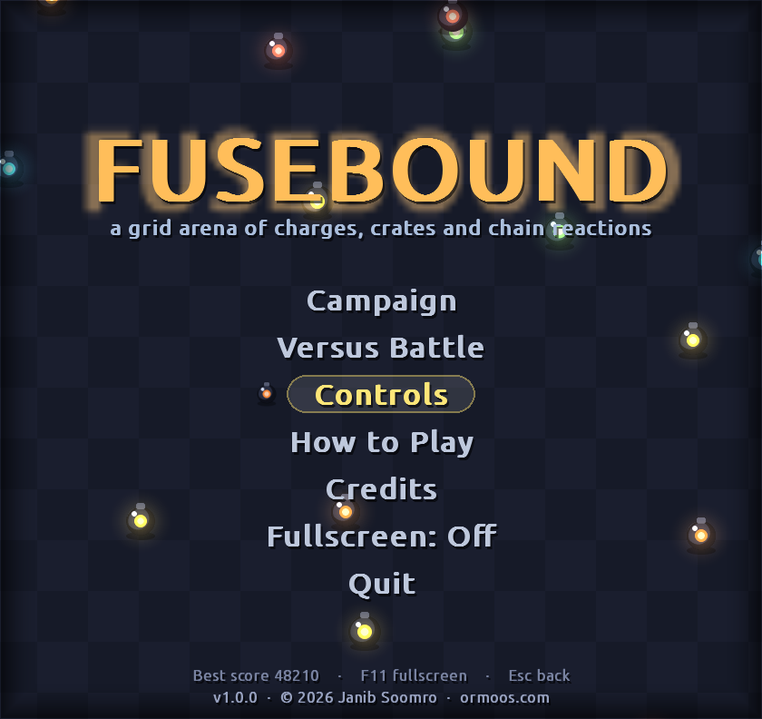
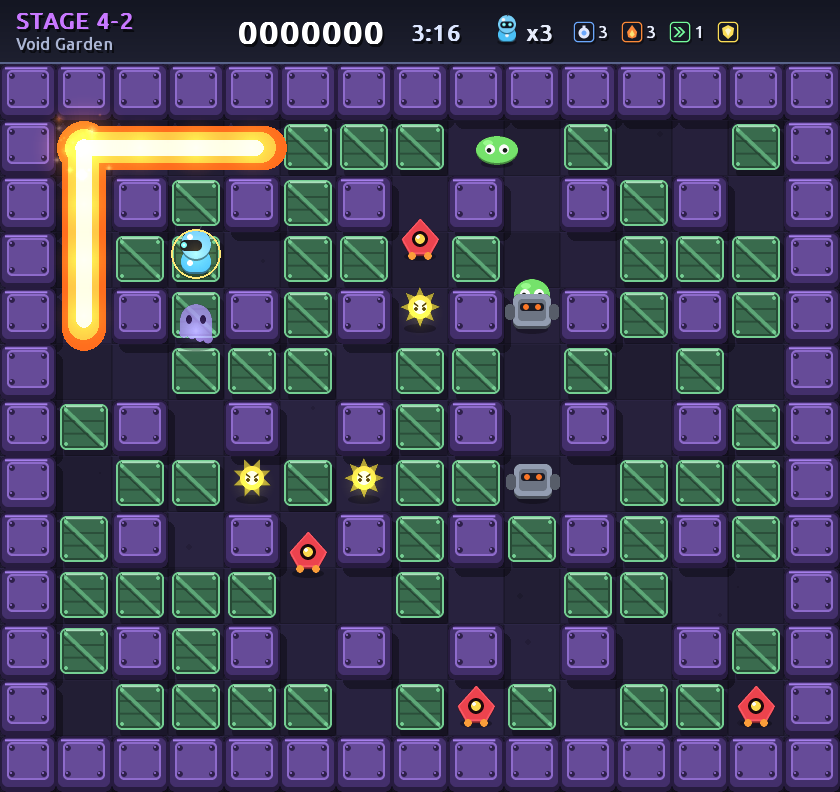
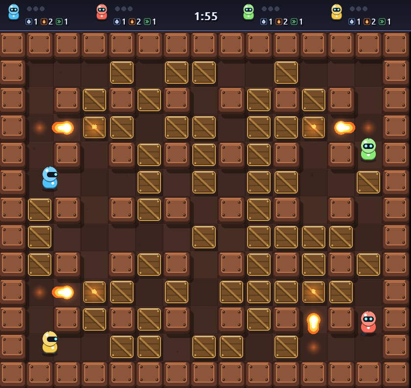
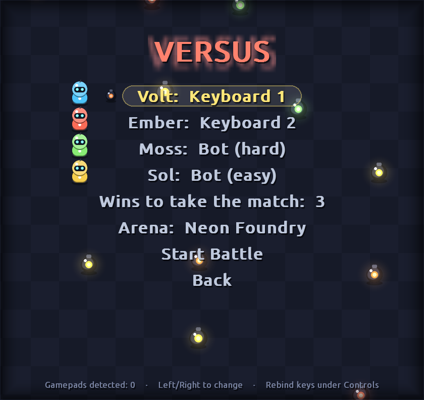
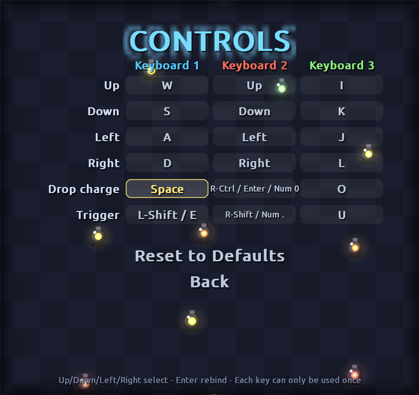
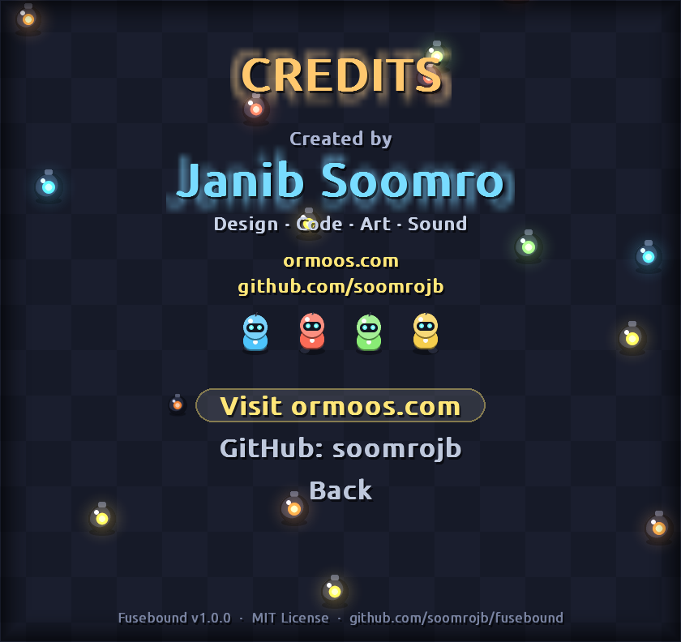

<h1 align="center">💥 Fusebound</h1>

<p align="center">
  <b>A grid-arena bomb battler for Linux with crates, chain reactions and couch multiplayer.</b><br>
  Every sprite, sound effect and music track is generated in code. There are no asset files.
</p>

<p align="center">
  Created by <a href="https://ormoos.com"><b>Janib Soomro</b></a> ·
  <a href="https://ormoos.com">ormoos.com</a> ·
  <a href="https://github.com/soomrojb">github.com/soomrojb</a>
</p>

<p align="center">
  
  
</p>
<p align="center">
  
  
</p>

---

## Features

- **Campaign:** 20 stages across 4 themed worlds (*Neon Foundry, Frost Circuit, Ember Ruins, Void Garden*). Defeat every enemy, then find the portal hidden under one of the crates. Your progress and best score are saved.
- **Versus Battle:** up to 4 fighters on one machine. Each slot can be one of three keyboard layouts, a gamepad or a bot (easy or hard). Play first-to-N rounds. When the timer runs out, **sudden death** starts and blocks fill the arena in a spiral.
- **5 enemy types**, each moving in its own way. Wanderers pick random routes. Hunters track you down with pathfinding. Wisps drift through crates, and armored brutes take two hits.
- **6 power-ups:** extra charge, bigger blast, speed, remote trigger, phase-walk through crates, and a one-hit shield.
- **Chain reactions:** blasts set off other charges they reach.
- **Smart bots** that predict where blasts will land and plan escape routes before dropping a charge.
- **Modern presentation:** anti-aliased sprites, additive glow lighting, particles, screen shake and a resizable window with fullscreen.
- **Synthesized audio:** chiptune music and sound effects are generated when the game starts.
- **Gamepad support** in menus and in game.

## Getting started

**Requirements:** Linux with Python 3.10+ (tested on Ubuntu 26.04 with Python 3.14).

```bash
git clone https://github.com/soomrojb/fusebound.git
cd fusebound
./run.sh
```

The first run creates a local virtual environment in `.venv` and installs [pygame-ce](https://pyga.me/). Nothing is installed system-wide.

> If `run.sh` fails with a venv error, install the venv module first:
> `sudo apt install python3-venv`

**Add it to your application menu (optional):**

```bash
./install-desktop.sh
```

**Run manually** (if you manage your own environment):

```bash
pip install -r requirements.txt
python3 -m fusebound
```

## Controls

|              | Move           | Drop charge          | Remote trigger   |
|--------------|----------------|----------------------|------------------|
| **Player 1** | `W` `A` `S` `D` | `Space`              | `Left Shift` / `E` |
| **Player 2** | Arrow keys     | `Right Ctrl` / `Enter` | `Right Shift`    |
| **Player 3** | `I` `J` `K` `L` | `O`                 | `U`              |
| **Gamepad**  | D-pad / stick  | `A`                  | `B`              |

These are the defaults. Open **Controls** from the main menu to rebind any action for any of the
three keyboard layouts. Select an action, press `Enter`, then press the new key (`Esc` cancels).
A key can only be used by one action, so the game rejects a key that is already taken and
tells you where it is used. `Esc` and `F11` are reserved. Your bindings are saved with your
progress, and **Reset to Defaults** restores the table above.

In the campaign, any keyboard layout controls your fighter.
`Esc` pauses · `F11` toggles fullscreen.

<p align="center">
  
</p>

## Power-ups

| Icon | Name | Effect |
|---|---|---|
| 🔵 | **+1 Charge** | Carry one more charge at a time (max 8) |
| 🔥 | **+1 Blast** | Blasts reach one tile further |
| ⏩ | **Speed Up** | Move faster |
| 📡 | **Remote Trigger** | Charges wait until you trigger them |
| 👻 | **Phase Walk** | Walk through crates |
| 🛡️ | **Shield** | Survive one hit |

## Project layout

```
fusebound/
├── config.py    # tuning constants, world palettes, enemy stats
├── world.py     # simulation: grid, movement + corner assist, charges, chain blasts, enemies, sudden death
├── ai.py        # bot opponents: danger map + BFS escape planning
├── art.py       # procedural supersampled sprites and glow
├── render.py    # arena drawing, blasts, particles, screen shake
├── sfx.py       # synthesized sound effects and music
├── controls.py  # keyboard / gamepad input
├── scenes.py    # menus, campaign, versus, HUD
└── game.py      # window + main loop
```

Save data lives in `~/.local/share/fusebound/save.json`.

## In-game help

- **How to Play** (main menu) lists every control and what each power-up does.
- **Credits** (main menu) has links to [ormoos.com](https://ormoos.com) and [GitHub](https://github.com/soomrojb) that open in your browser.

<p align="center">
  
</p>

## Contributing

Issues and pull requests are welcome. Ideas on the roadmap:

- Boss stages at the end of each world
- Level editor
- Online play
- More enemy types and arena hazards

## Author

**Janib Soomro**
- Website: [ormoos.com](https://ormoos.com)
- GitHub: [@soomrojb](https://github.com/soomrojb)

If you enjoy Fusebound, consider giving the repo a ⭐.

## License

[MIT](LICENSE) © 2026 Janib Soomro. Fusebound is an original work inspired by the arena-bomber genre.
